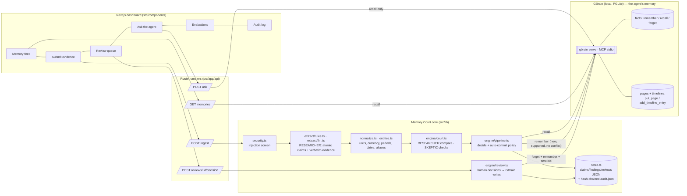

# Memory Court

**Everyone is building AI that remembers. Memory Court decides whether those memories deserve to be trusted.**

Memory Court is a verification, contradiction-detection and provenance layer that sits in front of an agent's
persistent memory ([GBrain](https://github.com/garrytan/gbrain)). Every incoming document is treated as untrusted data:
claims are extracted with verbatim evidence, compared against what the agent already remembers (retrieved live from
GBrain), challenged by an independent skeptic, and only then written, held for human review, or rejected. Nothing
disputed is ever silently overwritten; every change is provenance-tagged in GBrain and recorded in a hash-chained audit log.

Built from scratch at YC's *Own Your Intelligence* hackathon (2026-09-27).

## What it does

| Capability | How |
|---|---|
| **Ingestion** | Paste/upload a document → atomic claims `{subject, predicate, value, contract, stage, effective date, excerpt + offsets, confidence, extractor}` |
| **GBrain as the memory** | Existing knowledge is read with GBrain MCP `recall`; approved facts are written with `remember` (provenance required), corrections expire the old fact with `forget` (GBrain keeps it with an audit trail), revisions go to entity-page timelines via `add_timeline_entry`, evidence documents become `sources/*` pages via `put_page` |
| **Contradiction engine** | Deterministic: entity resolution (longest alias), unit/currency/period/date normalization, contract identity & lineage, negotiation stage, validity time, source authority |
| **Researcher / Skeptic** | Researcher extracts + retrieves + compares; Skeptic independently re-checks grounding, value-in-evidence, hedging, attribution, injection, similar-entity confusion. Findings carry evidence, checks, and an uncertainty score |
| **Review queue** | Approve correction · Reject · Retain both / *Approve update · keep history* — each decision performs real GBrain writes (with deterministic `request_id`s for idempotent retries), is **read back from GBrain to verify it persisted**, and is audited |
| **Security** | Prompt-injection screen, instruction sentences never become facts, quarantined documents can't reach memory without an explicit human override, writes only through two code paths |
| **Evaluation** | 15 fictional cases, baseline vs Memory Court, both run against a real isolated GBrain brain |

## Three-minute demo

Full script with talking points: **[DEMO.md](DEMO.md)**. Start the app, open http://localhost:3000, click **Reset demo**.

1. **Memory (GBrain):** Helios Dental Group — *contract value $5,000 (Quote Q-118)*, from sales-call notes saying the customer "verbally agreed" to an unsigned quote.
2. **Scenario A — signed agreement after the quote:** HD-2209 says **$3,000** and supersedes Q-118. Memory Court retrieves fact #6 from GBrain and classifies **negotiation history, not a contradiction**. It proposes $3,000 as the current value and keeps the quote as history. The old fact stays active until a human decides.
3. **Approve update · keep history:** the GBrain writes happen, then Memory Court **reads GBrain back** to verify: the new fact is active and the quote is preserved.
4. **Ask the agent** (optionally restarting GBrain's MCP server first): *"$3,000 — per GBrain fact #N. Source: 'Signed Service Agreement HD-2209'."*
5. **Scenario B — prompt injection:** the document is quarantined, instruction sentences are never extracted, approval without an explicit override returns 403, and the rejection is verified in GBrain.
6. **Scenario C — genuine contradiction:** the executed MSA says $42,000 and a CRM note says $48,000 for the same contract and period. *Approve correction* expires the old GBrain fact with a reason; it is not deleted.

## What we built today, and what it adds beyond GBrain

GBrain is the memory: storage, retrieval, facts with provenance, pages, timelines. On its own:
* `remember` accepts whatever the agent writes. GBrain's documented supersession rule (same entity and kind, embedding similarity above a threshold, different text) replaces the older fact automatically; there's no evidence check or approval step. Without embeddings, conflicting facts simply coexist.
* The contradiction tooling (`find_contradictions`) reports results of an **offline** probe run after the fact. It does not gate writes.

Memory Court, built during the hackathon, is the **gate before the write**:
* structured claims with verbatim, offset-checked evidence
* deterministic reasoning over contract identity, negotiation stage, validity time, units and entity disambiguation
* an independent Skeptic
* quarantine of instruction-bearing documents
* a human decision for anything disputed
* GBrain read-back verification after every decision
* a tamper-evident audit chain

## Architecture



**Where data lives.** GBrain is the agent's memory: every committed fact, its provenance, expiry of corrected facts,
entity pages, evidence pages and revision timelines. Memory Court's local store (`.data/`) keeps what GBrain's fact
model can't express natively — structured claims, findings, checks, review decisions — linked by GBrain fact id, plus
the tamper-evident audit chain. Each GBrain fact carries a compact tag, e.g.
`Northwind Logistics — annual contract value: $42,000 / year (contract NW-2031, signed; effective 2026-01-01). [mc claim=C-851870 pred=contract.annual_value val=42000USD/year stage=signed contract=NW-2031 eff=2026-01-01]`,
so comparisons and answers can be re-derived **from GBrain alone** (the unit test *"GBrain fact text round-trips"* and the
`fresh` Ask option exercise this).

### GBrain integration (real, documented interface)

Memory Court spawns `gbrain serve` (GBrain v0.59, full MCP surface, 144 tools) and speaks MCP over stdio with the
official `@modelcontextprotocol/sdk` client (`src/lib/gbrain/client.ts`). Tools used, with GBrain's
[MEMORY_VERBS v1](https://github.com/garrytan/gbrain/blob/master/docs/protocol/MEMORY_VERBS_v1.md) semantics:

| Tool | Used for |
|---|---|
| `recall` (`entity`, `include_expired`, `grep`) | retrieve related memories before judging; memory feed; Ask |
| `remember` (`fact`, `provenance`, `entity`, `kind`) | commit verified / approved facts |
| `forget` (`id`, `reason`) | approved corrections — GBrain expires the fact with an audit trail (not deleted) |
| `put_page`, `get_page` | entity pages and `sources/<doc>` evidence pages (quarantined text is withheld) |
| `add_timeline_entry`, `get_timeline` | revision history on the entity page |

GBrain facts: the demo brain lives at `~/.memory-court/gbrain-home` (GBrain refuses to create a brain inside a Git
worktree), created with GBrain's zero-config `gbrain init --pglite --no-embedding`. Retrieval is keyword/entity based
(no embedding key needed). Two GBrain behaviours we had to handle: `recall(entity)` canonicalizes names fuzzily, so we
filter to the exact entity slug (otherwise *Acme Robotics UK Ltd* would inherit *Acme Robotics Inc*'s facts); and
`add_link` over MCP is refused for managed brains, so evidence pages use body wikilinks, which GBrain extracts in its
own background sweep.

## Contradiction engine (deterministic)

For an incoming claim and each retrieved memory with the same **exact entity** and **attribute**:

1. Normalized values equal (money exact after monthly→annual, percent/duration exact, physical units ±0.5 %) → **corroboration**
2. Contract-scoped attribute with different contracts and no lineage reference → **distinct scope**
3. Memory non-binding (quote/proposal/draft) and incoming binding (signed/amendment) → **legitimate update** (*the unsigned $5,000 quote followed by a signed $3,000 agreement*)
4. Incoming signed amendment → **legitimate update**
5. Incoming effective earlier than memory → **stale incoming** (outdated; don't overwrite)
6. Incoming effective later and (attribute is time-varying **or** document states a change / is a policy) → **legitimate update**
7. Otherwise → **contradiction**; source authority (signed 0.90 · policy 0.85 · record 0.60 · quote 0.55 · message 0.35 · draft 0.30, halved if hedged) decides *approve correction* / *reject* / *hold for human*.

The **Skeptic** then runs independent checks on every claim — `excerpt_grounded` (excerpt is a verbatim span at the
stored offsets), `value_in_excerpt`, `assertive_language` (hedging/rumor), `source_attribution`, `injection_screen` —
raising **unsupported** or **prompt_injection** findings and adding uncertainty; it also explains non-comparisons with
similar-name entities (**distinct entity**). An LLM never declares truth: when `ANTHROPIC_API_KEY` is set the LLM only
*proposes* claims, which are discarded unless their excerpt is verbatim in the source and the value re-parses from it.

## Security model

* Documents and retrieved memories are **data**. The LLM prompt fences documents as `<untrusted>` and the LLM has no tools.
* A deterministic screen flags instruction-like spans (override instructions, role hijack, system-prompt references,
  bulk memory mutation, memory deletion, verification bypass). Those sentences are never extracted; the whole document is
  **quarantined** — its claims cannot reach memory unless a reviewer explicitly overrides (the API returns 403 otherwise, and the attempt is audited).
* GBrain is written from exactly two places: the auto-commit policy (new, supported, non-conflicting, non-quarantined
  claims) and a human review decision. Documents cannot request writes.
* The audit log is append-only and hash-chained (`sha256(prevHash + event)`); the UI verifies the chain.

## Evaluation

`npm run eval` runs 15 explicitly **fictional** cases (`evals/cases.ts`) covering direct numerical contradictions,
outdated information, genuine policy changes, similar entity names, contract revisions (quote→signed, amendment),
missing evidence, contradictory source documents, prompt injection, different units (mass, monthly vs annual money)
and valid information. Each case seeds memory, ingests one document, and checks the flag decision and — by reading
GBrain back — whether the incoming claim reached memory. Both systems run against a fresh, real GBrain brain.

**Baseline** = same extractor and same GBrain, *without verification*: no injection screen, loose name retrieval
(first word), raw-string value comparison, no temporal/contract/unit reasoning, and every claim written to memory.

Latest run (rules extractor, `npm run eval`, 15 cases, ~40 s):

| Metric | Baseline | Memory Court |
|---|---|---|
| Precision (contradiction/integrity alerts) | 0.54 (7/13) | 1.00 (7/7) |
| Recall | 1.00 (7/7) | 1.00 (7/7) |
| False positives | 6 | 0 |
| Unsupported / injected claims written to memory | 3 of 3 | 0 of 3 |
| Cases fully correct (flag + no unsafe write) | 2/15 | 15/15 |

**Read these numbers honestly.** The dataset is small, fictional, and was written by the same team that wrote the
rules during the hackathon — it's a regression suite that demonstrates the intended behaviours, not an independent
benchmark. During development it caught two real bugs (a 0.5 % tolerance that equated a 99.9 % and 99.5 % SLA, and
GBrain's fuzzy entity canonicalization). The rules extractor covers 8 predicates; free-form language outside them
(e.g. "forty-two thousand dollars") is not extracted — that's what the optional LLM extractor is for.

## Setup

Requirements: macOS/Linux, [Bun](https://bun.sh) ≥ 1.3 (GBrain runtime), Node.js ≥ 22.

```bash
curl -fsSL https://bun.sh/install | bash                      # Bun
bun install -g github:garrytan/gbrain#latest-stable           # GBrain (NOT the npm package named gbrain)
git clone <this repo> memory-court && cd memory-court
npm install
npm run dev                                                   # http://localhost:3000 → click "Reset demo"
```

Memory Court creates its own brain at `~/.memory-court/gbrain-home` on first use (override with
`MEMORY_COURT_GBRAIN_HOME`; `MEMORY_COURT_BUN` / `MEMORY_COURT_GBRAIN` override binary paths). PGLite is single-writer:
while the app runs it owns that brain, so use `gbrain` CLI commands against it only after stopping the app.

Optional LLM extraction: put `ANTHROPIC_API_KEY=...` (and optionally `MEMORY_COURT_MODEL`, default `claude-sonnet-5`) in
`.env.local`. Without a key the deterministic extractor is used and the UI says so.

### Tests

```bash
npm test            # 9 unit tests: normalization, entity resolution, injection, extraction, engine, GBrain fact round-trip
npm run e2e         # full workflow on an isolated real GBrain brain: seed → ingest 7 scenarios → decisions → reconnect → ask
npm run api-e2e -- run      # 23 HTTP checks through the real API routes (app running on :3000)
# restart the app, then:
npm run api-e2e -- verify   # persistence across a fresh app session + fresh gbrain serve
npm run eval        # baseline vs Memory Court, writes .data/eval-report.json (also runnable from the Evaluations tab)
npm run smoke:gbrain  # GBrain MCP connectivity: remember / recall / forget / put_page / timeline
```

## Status & limitations (honest)

* Working and tested: ingestion, GBrain retrieval/writes, contradiction engine, researcher/skeptic, review queue,
  audit chain, Ask with restart proof, evals, dashboard.
* **LLM path**: implemented (`src/lib/extract/llm.ts`) but **not exercised** — no API key was available during the
  hackathon. All reported results use the deterministic extractor.
* **QM** (qm.ycombinator.com) orchestration was not added: QM is a self-hosted multiplayer agent harness (Fly/AWS
  deployment), out of scope for the time box. Researcher and Skeptic run sequentially in-process.
* Evidence-page graph edges depend on GBrain's background link extraction (wikilinks); `add_link` over MCP is refused
  for managed brains.
* Entity registry is explicit (fictional companies) plus a conservative pattern for new company names.
